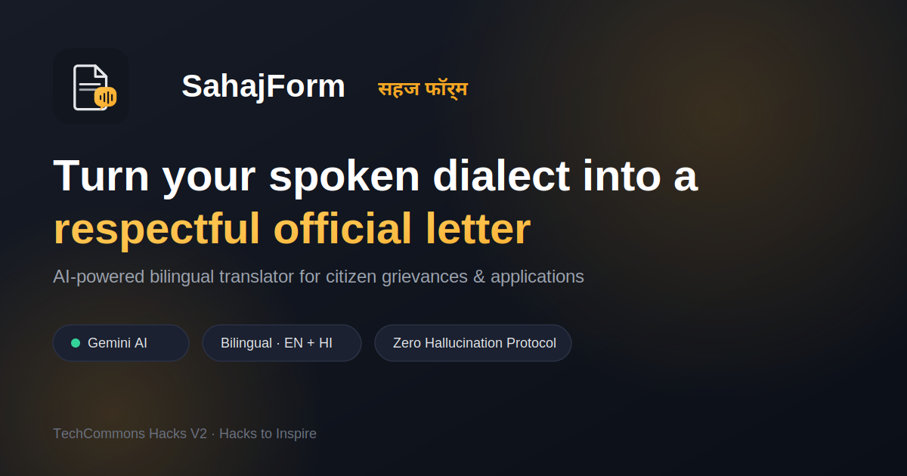
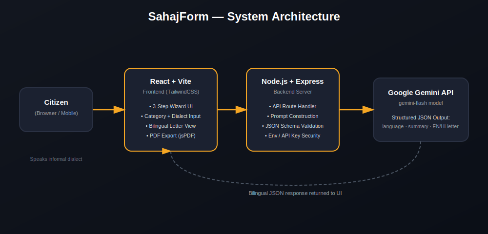
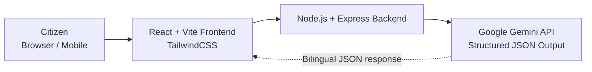
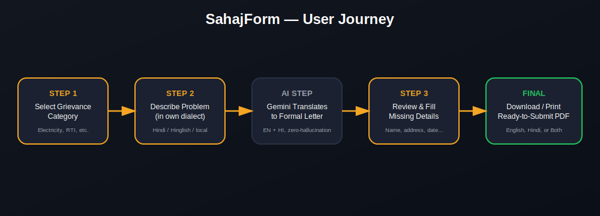
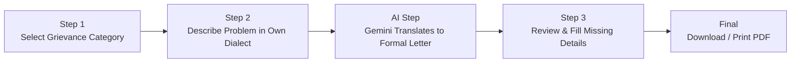

<div align="center">


# SahajForm | सहज फॉर्म

### Turn your spoken dialect into a respectful official letter

**AI-powered bilingual translator that converts informal citizen grievances into formal government applications — in English and Hindi.**

[](https://ai.google.dev/)
[](https://react.dev/)
[](https://nodejs.org/)
[](https://vitejs.dev/)
[](#license)

[Live Demo](https://sahajform.onrender.com) · [Report Bug](https://github.com/shivamdwivedicse/SahajForm/issues) · [Request Feature](https://github.com/shivamdwivedicse/SahajForm/issues)



</div>

---

## Table of Contents

- [About the Project](#about-the-project)
- [The Problem](#the-problem)
- [Key Features](#key-features)
- [System Architecture](#system-architecture)
- [User Flow](#user-flow)
- [Tech Stack](#tech-stack)
- [Demo](#demo)
- [Getting Started](#getting-started)
- [Environment Variables](#environment-variables)
- [Deployment](#deployment)
- [Zero-Hallucination Design Principle](#zero-hallucination-design-principle)
- [Roadmap](#roadmap)
- [Contributing](#contributing)
- [Contact](#contact)

---

## About the Project

**SahajForm** helps Indian citizens convert informal, spoken-style descriptions of their problems — in Hindi, Hinglish, Bhojpuri, or any local dialect — into polite, properly structured **official government application/complaint letters**, generated simultaneously in **English and Hindi**, ready to print and submit.

It was built for **TechCommons Hacks V2 — Hacks to Inspire**, under the theme of AI for Social Good.

## The Problem

Millions of citizens in rural and semi-urban India struggle to write formal complaint letters for basic civic issues — electricity outages, ration card disputes, water supply problems, police complaints, RTI requests, and more. They understand their problem perfectly, but not the *formal bureaucratic language* required to file it. This gap causes genuine grievances to go unreported or get rejected due to incomplete/informal applications.

**SahajForm removes that language barrier entirely.**

## Key Features

| Feature | Description |
|---|---|
| 🗣️ **Dialect Input** | Accepts casual Hindi, Hinglish, or regional dialects — typed or spoken |
| 🏛️ **7 Grievance Categories** | Electricity, Ration Card, Water Supply, Police Complaint, RTI, School Admission, General Administrative |
| 🌐 **Bilingual Output** | Generates matching formal letters in English **and** Hindi simultaneously |
| ✅ **Zero-Hallucination Protocol** | Never invents facts — missing details (name, address, date) are flagged as clear placeholders |
| 📝 **Live Placeholder Editing** | Fill in missing details once — both letters update in real time |
| 📄 **Flexible PDF Export** | Download English only, Hindi only, or a combined bilingual PDF |
| 🖨️ **Print-Ready Formatting** | Official A4 layout, ready to sign and submit |

## System Architecture

<div align="center">

</div>



The frontend collects the grievance category and informal description, sends it to an Express backend, which constructs a schema-constrained prompt and calls the **Google Gemini API**. Gemini returns strict JSON (`detected_language`, `summary`, `formal_english`, `formal_hindi`, `missing_info`), which the frontend renders as two side-by-side official letter cards.

## User Flow

<div align="center">

</div>



## Demo

> 🎥 *Add your screen-recorded demo GIF/video here.*
> Suggested: record a full run — select category → describe grievance in Hinglish → generate → fill missing fields → download PDF — and save it as `docs/assets/demo.gif`, then reference it below:
>
> 
> [SahajForm Demo](./docs/assets/demo.gif)
>

## Tech Stack

**Frontend:** React 19 · Vite · TypeScript · TailwindCSS · Lucide Icons · jsPDF
**Backend:** Node.js · Express · TypeScript (via `tsx` / `esbuild`)
**AI:** Google Gemini API (`@google/genai`) — structured JSON schema output
**Deployment:** Render

## Getting Started

### Prerequisites
- Node.js (v18+)
- A [Google Gemini API key](https://aistudio.google.com/app/apikey)

### Installation

```bash
git clone https://github.com/shivamdwivedicse/SahajForm.git
cd SahajForm
npm install --legacy-peer-deps
```

### Run locally

```bash
npm run dev
```

Visit `http://localhost:3000` (or the port shown in your terminal).

### Build for production

```bash
npm run build
npm run start
```

## Environment Variables

Create a `.env.local` file in the project root:

```env
GEMINI_API_KEY=your_gemini_api_key_here
```

## Deployment

SahajForm is deployed on **[Render](https://render.com)**.

| Setting | Value |
|---|---|
| Build Command | `npm install && npm run build` |
| Start Command | `npm run start` |
| Environment Variable | `GEMINI_API_KEY` |

Live: **[sahajform.onrender.com](https://sahajform.onrender.com)**

## Zero-Hallucination Design Principle

SahajForm's AI prompt is constrained by a strict JSON schema and explicit instructions to **never fabricate** facts — consumer numbers, names, dates, or allegations the citizen didn't state. Any detail the AI cannot infer from the user's input is surfaced as an **editable placeholder** (e.g. `[Consumer ID]`), not guessed. This makes the tool practically trustworthy for real bureaucratic submission.

## Roadmap

- [ ] Voice input (speech-to-text) for fully non-literate accessibility
- [ ] More grievance categories (pension, land records, health schemes)
- [ ] "Track your application" — follow-up reminders after submission
- [ ] Multi-dialect detection improvements (Bhojpuri, Haryanvi, Maithili, etc.)

## Contributing

Contributions, issues, and feature requests are welcome!

1. Fork the repo
2. Create your feature branch (`git checkout -b feature/AmazingFeature`)
3. Commit your changes (`git commit -m 'Add some AmazingFeature'`)
4. Push to the branch (`git push origin feature/AmazingFeature`)
5. Open a Pull Request

## License

Distributed under the MIT License.

---

## Contact

**Shivam Dwivedi**

[](https://www.github.com/shivamdwivedicse)
[](https://www.linkedin.com/in/shivam-dwivedi-27661a395/)
[](mailto:Shivamdwivedicse20919@gmail.com)
[](https://discord.com/users/shivamdwivedi0919)

Project Link: [https://github.com/shivamdwivedicse/SahajForm](https://github.com/shivamdwivedicse/SahajForm)

<div align="center">
<sub>Built by Shivam Dwivedi and with lot of coffee</sub>
</div>
