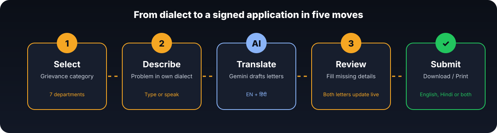
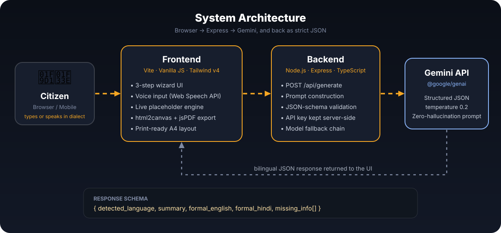
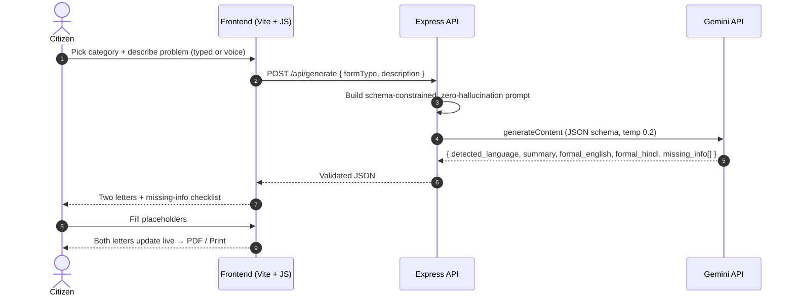

<div align="center">



<br/>

<a href="https://sahajform.onrender.com"></a>
&nbsp;
<a href="https://github.com/shivamdwivedicse/SahajForm/issues"></a>
&nbsp;
<a href="#-quick-start"></a>

<br/><br/>

**AI-powered bilingual translator that turns informal citizen grievances into formal government applications, in English and Hindi.**

<sub>🏆 Built for **TechCommons Hacks V2 — Hacks to Inspire** · Theme: AI for Social Good</sub>

<br/>


<sub>Full run in 20 seconds: category → speak or type in your dialect → bilingual letters → fill the gaps → download.</sub>

<br/><br/>

<table>
  <tr>
    <td align="center" width="25%"><h1>7</h1><sub>GRIEVANCE<br/>CATEGORIES</sub></td>
    <td align="center" width="25%"><h1>2</h1><sub>LANGUAGES,<br/>ONE CLICK</sub></td>
    <td align="center" width="25%"><h1>3</h1><sub>STEPS FROM<br/>PROBLEM TO PDF</sub></td>
    <td align="center" width="25%"><h1>0</h1><sub>INVENTED<br/>FACTS</sub></td>
  </tr>
</table>

<p>
  <a href="#-the-problem"><b>Problem</b></a> &nbsp;·&nbsp;
  <a href="#-features"><b>Features</b></a> &nbsp;·&nbsp;
  <a href="#-how-it-works"><b>How it works</b></a> &nbsp;·&nbsp;
  <a href="#-architecture"><b>Architecture</b></a> &nbsp;·&nbsp;
  <a href="#-tech-stack"><b>Stack</b></a> &nbsp;·&nbsp;
  <a href="#-quick-start"><b>Quick start</b></a> &nbsp;·&nbsp;
  <a href="#-roadmap"><b>Roadmap</b></a>
</p>

</div>

<br/>

## 😶 The Problem

Millions of citizens in rural and semi-urban India know *exactly* what is wrong: the transformer burnt out, the ration dealer refuses grain, the pipeline has been leaking for a week. What they don't have is the **formal bureaucratic language** an office expects. So genuine complaints go unfiled, or get rejected for being informal or incomplete.

**SahajForm removes the language barrier.**

<table>
  <tr>
    <th align="center" width="50%">🗣️ What the citizen says</th>
    <th align="center" width="50%">📄 What SahajForm writes</th>
  </tr>
  <tr>
    <td valign="top"><i>"Bhaiya hamare mohalle me 3 din se light gayab hai. Transformer se bahut zor se aawaz aayi thi, dhuan nikla tha. Bacchon ki pariksha chal rahi hai, inverter bhi dead ho gaya. Line man ko bola to bolta hai mere paas saman nahi hai…"</i></td>
    <td valign="top"><i>"Respected Sir/Madam, I most respectfully submit that there has been no electricity supply in our locality for the past three days. A loud noise followed by smoke was observed from the local transformer… I humbly request you to arrange its replacement at the earliest."</i><br/><br/><sub>+ the same letter in formal हिंदी, side by side.</sub></td>
  </tr>
</table>

<br/>

## ✨ Features

<table>
  <tr>
    <td width="33%" valign="top">
      <h3>🗣️ Speak your dialect</h3>
      Hindi, Hinglish, Bhojpuri, Haryanvi… type it, or tap the mic and just talk.
    </td>
    <td width="33%" valign="top">
      <h3>🏛️ 7 official formats</h3>
      Electricity, Ration Card, Water Supply, Police/GD, RTI, School/EWS, General (DM/SDM).
    </td>
    <td width="33%" valign="top">
      <h3>🌐 Two letters at once</h3>
      Formal English <b>and</b> शुद्ध हिंदी, generated together and shown side by side.
    </td>
  </tr>
  <tr>
    <td valign="top">
      <h3>🛡️ Zero-hallucination</h3>
      Never invents names, numbers or dates. Gaps become clear <code>[placeholders]</code>.
    </td>
    <td valign="top">
      <h3>⚡ Live placeholder fill</h3>
      Fill a detail once in the checklist and <b>both</b> letters update instantly.
    </td>
    <td valign="top">
      <h3>📄 PDF, print, copy</h3>
      English-only, Hindi-only or combined A4 PDF. Print-ready, sign and submit.
    </td>
  </tr>
</table>

<br/>

## 🧭 How it works

<div align="center">

</div>

<br/>

## 📐 Architecture

<div align="center">

</div>

<br/>

<details>
<summary><b>🔎 See the request/response sequence</b></summary>



</details>

<br/>

## 🧰 Tech Stack

<div align="center">


<br/>


</div>

| Layer | What we use |
|---|---|
| **Frontend** | Vite · vanilla JavaScript · Tailwind CSS v4 · Web Speech API (voice) · html2canvas + jsPDF |
| **Backend** | Node.js · Express · TypeScript (`tsx` for dev, `esbuild` for prod) |
| **AI** | Google Gemini via `@google/genai`, strict JSON-schema output, low temperature |
| **Hosting** | Render |

<br/>

## 🔒 Zero-Hallucination Design Principle

> [!IMPORTANT]
> A government application with an invented consumer number is worse than no application. SahajForm's prompt is locked to a strict JSON schema and instructed to **never fabricate** names, IDs, dates or allegations the citizen didn't state.

Whatever the AI can't infer becomes an **editable placeholder** (for example `[Consumer ID]`) and a line in the *Missing Information Checklist*. Fill it once; both letters update. Nothing goes out unreviewed.

<br/>

## 🚀 Quick Start

```bash
git clone https://github.com/shivamdwivedicse/SahajForm.git
cd SahajForm
npm install --legacy-peer-deps
```

Create `.env.local` in the project root ([get a free Gemini key](https://aistudio.google.com/app/apikey)):

```env
GEMINI_API_KEY=your_gemini_api_key_here
```

```bash
npm run dev          # http://localhost:3000
```

<details>
<summary><b>📦 Production build &amp; ☁️ deploy on Render</b></summary>

<br/>

```bash
npm run build
npm run start
```

| Render setting | Value |
|---|---|
| Build command | `npm install && npm run build` |
| Start command | `npm run start` |
| Environment variable | `GEMINI_API_KEY` |

</details>

> [!NOTE]
> Requires **Node.js 18+**. Voice input uses the browser's speech service, so it works best in Google Chrome.

<br/>

## 📍 Roadmap

- [x] Bilingual letters (English + Hindi) with zero-hallucination placeholders
- [x] Live placeholder editing, PDF export (EN / HI / combined), print layout
- [x] Voice input (Hindi / Hinglish) via the Web Speech API
- [ ] More categories: pension, land records, health schemes
- [ ] "Track your application": follow-up reminders after submission
- [ ] Better dialect detection (Bhojpuri, Haryanvi, Maithili…)
- [ ] Offline-friendly PWA for low-connectivity areas

<br/>

## 🤝 Contributing

Issues and pull requests are welcome.

```bash
git checkout -b feature/AmazingFeature
git commit -m "Add some AmazingFeature"
git push origin feature/AmazingFeature   # then open a Pull Request
```

<br/>

## 👤 Author

<div align="center">

**Shivam Dwivedi**

[](https://www.github.com/shivamdwivedicse)
[](https://www.linkedin.com/in/shivam-dwivedi-27661a395/)
[](mailto:Shivamdwivedicse20919@gmail.com)
[](https://discord.com/users/shivamdwivedi0919)

<br/>

<sub>Distributed under the MIT License.</sub>

<br/>

**सहज फॉर्म** · *Every citizen deserves to be heard in the language the office understands.*

</div>